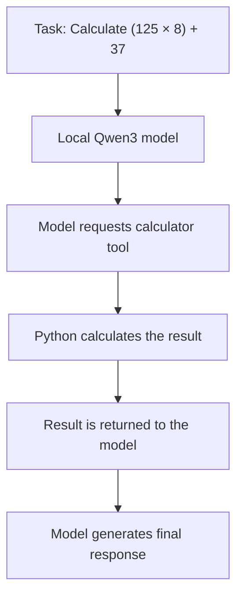

# Local AI Agent: Run an AI Agent on Your Own Machine

Want to experiment with AI agents without starting with a cloud API, API keys, or a complicated framework?

This project is a hands-on starting point for running a language model locally and connecting it to a Python tool. You'll set up Ollama, download a model, run a Python agent, and see how the model uses a tool to complete a task.

The goal is to make the basics easy to understand, run, and extend.

## What you'll build

A small Python agent that uses a local Qwen3 model through Ollama.

The agent receives a math task, asks the model to use a Python calculator tool, passes the calculation result back to the model, and prints its final response.

**You'll learn how to:**

- Run a language model on your own computer.
- Connect Python to a local LLM using Ollama.
- Give an LLM access to a Python function through tool calling.
- Pass tool results back to the model.
- Build a simple agent loop with a maximum step limit.
- Validate arithmetic expressions without using Python's `eval()`.

## How it works



The language model decides when to request the calculator tool. Python executes the calculation, and the model receives the result to continue the conversation.

This is a small educational example, not a general-purpose autonomous assistant. The task is currently defined in `agent.py`, so the program runs a predefined example rather than accepting arbitrary prompts interactively.

## Prerequisites

You'll need:

- A Mac, Windows PC, or Linux machine.
- Python 3.10 or newer.
- [Ollama](https://ollama.com/download) installed and running.
- Enough available memory to run the selected model.

This project uses `qwen3:8b`. The model download takes several gigabytes of disk space, and inference speed depends on your hardware. If it runs too slowly, consider a smaller model that supports tool calling and update the `MODEL` value in `agent.py`.

No separate cloud AI API key is required for the local model configuration used here.

## Step 1: Install Ollama

Download and install Ollama for your operating system:

**[Download Ollama](https://ollama.com/download)**

Ollama runs the model locally and provides an interface that Python applications can use to send prompts and receive responses.

After installation, open a terminal and check that the command is available:

```bash
ollama --version
```

If the command isn't found, finish the installation and ensure Ollama is available in your terminal.

## Step 2: Download the language model

Run:

```bash
ollama pull qwen3:8b
```

This downloads the model to your computer. You only need to download it once unless you remove it or choose another model.

Verify that it is installed:

```bash
ollama list
```

You should see `qwen3:8b` in the list.

### Test the model before using Python

Run:

```bash
ollama run qwen3:8b
```

Try a simple prompt, such as:

```text
Explain what an AI agent is in two sentences.
```

If the model responds, the local inference setup is working.

Exit the interactive model session with:

```text
/bye
```

Keep Ollama running and available while you use the Python agent. Depending on your operating system and installation, you may need to open the Ollama application or start its service.

## Step 3: Clone this repository

Clone the project from GitHub:

```bash
git clone https://github.com/chaitasipatel25/local-ai-agent.git
cd local-ai-agent
```

## Step 4: Create a Python environment

A virtual environment keeps the project's Python dependencies separate from other applications on your machine.

Create it:

```bash
python3 -m venv .venv
```

Activate it on macOS or Linux:

```bash
source .venv/bin/activate
```

On Windows PowerShell, activate it with:

```powershell
.venv\Scripts\Activate.ps1
```

If your system uses `python` instead of `python3`, use the command available on your machine.

## Step 5: Install the dependency

Upgrade pip and install the Ollama Python client:

```bash
python -m pip install --upgrade pip
python -m pip install ollama
```

The Python client allows your application to communicate with Ollama without implementing the HTTP calls yourself.

## Step 6: Run the agent

From the repository directory, run:

```bash
python agent.py
```

The first run may take some time while the model loads, depending on your computer and whether the model is already loaded.

The agent will ask the model to calculate:

```text
(125 * 8) + 37
```

The correct result is:

```text
1037
```

You'll see output showing the tool call, its arguments, and the calculation result. The model then gets an opportunity to explain the answer.

The exact wording and number of tool calls may vary depending on the model's response.

**That's it — you've run a Python AI agent using a model hosted locally on your machine.**

## Understanding the code

The repository is intentionally small:

```text
local-ai-agent/
├── agent.py
├── README.md
└── .gitignore
```

### `agent.py`

The main program contains four important pieces.

**1. Model configuration**

```python
MODEL = "qwen3:8b"
MAX_STEPS = 5
```

`MODEL` selects the Ollama model. `MAX_STEPS` limits how many times the agent loop can call the model.

**2. Calculator tool**

The `calculate()` function supports basic addition, subtraction, multiplication, division, and unary positive or negative numbers.

It parses the expression with Python's AST and only evaluates explicitly supported operations. It does not execute arbitrary Python code.

**3. Tool calling**

The calculator is registered with the Ollama client:

```python
tools = [calculate]
```

The model can request that function with an arithmetic expression. Python runs the function and returns the result to the conversation.

**4. Agent loop**

The loop sends messages to the model, handles tool requests, and returns tool results to the model. It stops when the model provides a response without requesting another tool or the step limit is reached.

This illustrates a key idea behind tool-using agents: the model chooses a tool, but the application executes it.

## Troubleshooting

### `ollama: command not found`

Make sure Ollama is installed correctly. Restart your terminal after installation and try:

```bash
ollama --version
```

### Connection refused or unable to connect to Ollama

Ollama may not be running. Open the Ollama application or start its service for your operating system, then retry:

```bash
ollama list
```

### Model not found

Download the exact model configured in the script:

```bash
ollama pull qwen3:8b
```

The model name in `agent.py` must match an available model.

### The agent is slow

Local inference speed depends on available memory, hardware acceleration, and model size. Try a smaller model that supports tool calling, then change the `MODEL` constant accordingly.

### The model doesn't call the calculator

Tool calling depends on the model's capabilities and its response to the prompt. Check that you're using the expected model and that Ollama is working. Some models may behave differently or fail to request a tool reliably.

## Privacy and safety

When using a local model, prompts sent through this project's default configuration go to your local Ollama instance rather than a hosted AI API.

That does not guarantee that every application on your computer is offline or that no other software can access your data. Your system, network configuration, and any additional integrations still matter.

The calculator is deliberately restricted to a small set of arithmetic operations. If you extend the agent with file access, shell commands, network access, or other tools, add appropriate input validation, permissions, execution limits, and approval steps.

## Where to go next

Once you've run the example, try extending it:

- Accept a task from the command line instead of using a hardcoded prompt.
- Add unit tests for the calculator.
- Add another small tool, such as unit conversion.
- Add structured logging and better error handling.
- Let users select a model through configuration.
- Explore conversation history and multi-step tasks.
- Add approval gates before executing tools that change files or system state.

Keep changes small, run them locally, and test the behavior before adding more capabilities.

## Contributing

This project is intended as a learning resource for developers exploring local LLMs and tool-using agents.

Suggestions, bug reports, and pull requests are welcome. If you're new to AI agents, improving the setup instructions or adding tests is a great place to start.

## License

See the `LICENSE` file for the project's reuse terms.
